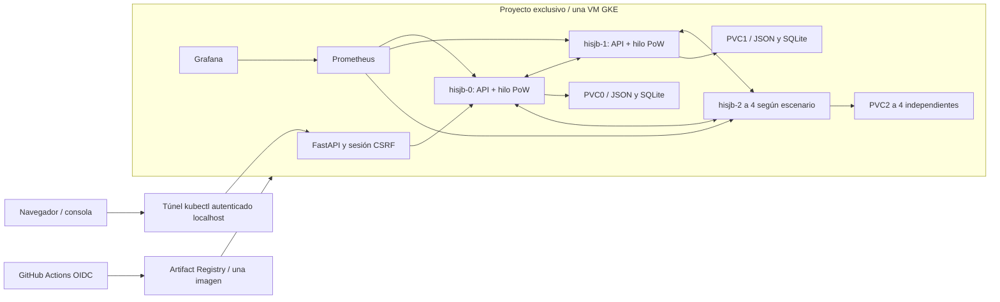

# Diagrama lógico del despliegue observado

Diagrama explicativo, no captura de infraestructura. Los cinco nodos lógicos comparten
una VM. La consola es servida por el mismo backend; A es una responsabilidad, no un
proceso adicional. El clúster temporal se elimina tras exportar evidencias.
